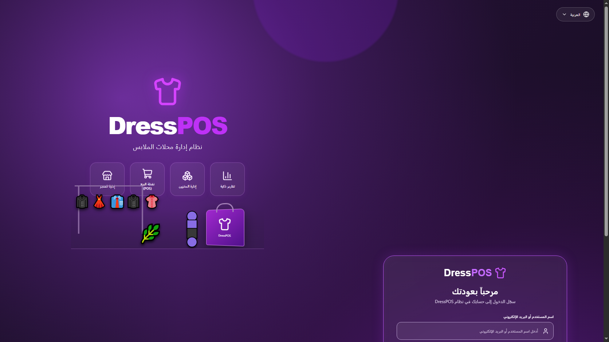

# DressPOS — Clothing Store POS Showcase

Arabic RTL interactive frontend prototype for a clothing store point-of-sale and management system. The project is a UI showcase powered by sample data; it does not connect to a production backend, payment provider, or real inventory.



## Live demo

https://elsayco.github.io/DressPOS/

## Run locally

Requirements: Node.js 20 or newer.

```powershell
cd Application
npm ci
npm run dev
```

Open the local URL printed by Vite. Enter any non-empty username and password to open the demo dashboard.

Build a production bundle with `npm run build` inside `Application`.

## Screens

Login, Dashboard, POS, Sales, Products, Inventory, Customers, Suppliers, Reports, Users, Store Administration, and Settings.

Browse [all screen captures](Deliverables/screenshots/) or read the [project documentation](Documentation/README.md).

## Demo notes

- The UI is Arabic and right-to-left, with responsive layouts.
- POS checkout, receiving stock, search, forms, detail panels, and reports use local sample data.
- Changes reset on page refresh. No real payment is taken and no data is saved to a server.

## Repository layout

- `Application/` — Vite + React app and local image assets.
- `Documentation/` — screen inventory, design mapping, workflows, QA, and limitations.
- `Deliverables/screenshots/` — desktop captures of the app routes.
- `*.png` at the root — supplied design references.
